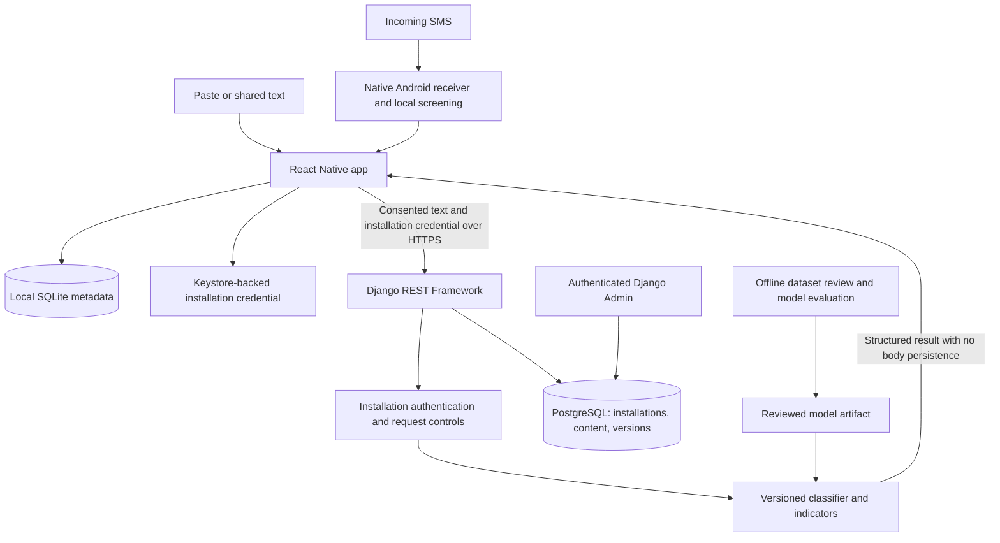

# SmishGuard project brief

**Academic title:** SmishGuard An Explainable Android SMS Phishing Detection and Awareness System

**Working app name:** SmishGuard

**Previous name:** Weightminer

**Last updated:** 22 October 2026

**Delivery:** Android APK for a university capstone demonstration

**Status:** The trained model, mobile frontend, protected Django APIs, restricted PostgreSQL roles and small staff operations console are implemented. The app has explicit consented online checking, secure installation credential storage, optional metadata feedback and published-lesson refresh. Backend/security tests pass; native phone verification requires a rebuild with SecureStore and remains pending. Existing/incoming SMS access, WhatsApp screening, public hosting and a standalone customer APK remain future milestones. See [the implemented backend guide](docs/BACKEND_GUIDE.md) and [client update](docs/CLIENT_UPDATE.md).

This is the living handoff document for the development and documentation collaborators. It records the current proposed product, accepted constraints, and decisions still requiring evidence. Update it as decisions change. It does not substitute for the final university report or measured evaluation results.

## 1. Project description

SmishGuard helps Android users assess SMS messages for phishing risk, understand observed warning signs, and avoid harmful interactions. It combines a mobile interface, native SMS integration, a Python detection backend, and reviewed awareness content. The intended experience requires no user registration, email address, phone-number verification, or profile.

A user can paste or share a message for assessment. On the demonstration phone, automatic incoming-message screening and warnings are also intended, subject to Android permission and background-behavior testing. Results describe low detected risk, suspicious content, or high phishing risk, together with observed indicators and recommended actions. A low-risk result is not a guarantee of legitimacy.

The research contribution is an evaluated SMS-phishing detection pipeline integrated with an understandable protective workflow. The system must distinguish spam from smishing, demonstrate false-positive behavior, and accurately describe the scope of its protection.

## 2. Decisions and boundaries

- The client has delegated technology selection, and the developer prefers React Native and Python Django. Use that stack.
- Use PostgreSQL for backend data. Do not introduce MongoDB alongside it.
- Use React Native with TypeScript for the mobile interface and Kotlin for required Android-native integration.
- Frontend workflow selected: Expo SDK 58 development builds with Expo Router. Local demo and consented online model modes are separate; native SMS integration remains future work. SecureStore adds a native dependency requiring a rebuilt client.
- Use Django REST Framework for the API and Django Admin for protected staff operations.
- Use SQLite for local scan metadata and preferences that suit structured storage. Store installation secrets through a maintained Android Keystore-backed secure-storage integration, not plaintext preferences or SQLite.
- Require no end-user login/logout, account profile, or verified phone number.
- Keep ordinary scan history on the phone; do not create a central inbox or an API to browse users' messages.
- Use per-installation credentials for online API calls without requiring a human account.
- Make cloud processing explicit and optional. Local rules provide a clearly limited fallback; full offline ML is a later enhancement unless selected sooner.
- Prioritize warning-based protection alongside the existing SMS app. A default-SMS inbox with quarantine is separate scope.
- SmishGuard is the selected working name for development documentation. Original reference documents retain their historical titles.
- Message languages, exact Android support matrix, deadline, and revised academic approval remain unresolved.

## 3. Technology rationale

### React Native and native Android

React Native matches the developer's familiarity and supports an accessible mobile interface. Native Android code is required where SMS reception, lifecycle handling, or secure storage is not provided by a maintained compatible library. Use a native Android build or custom Expo development build; do not depend on Expo Go for unsupported SMS modules. Decide the build workflow during the native feasibility experiment before pinning packages.

The Android layer must assemble multipart SMS, deduplicate events, perform prompt local checks, and handle background work without relying on a running JavaScript screen. Demonstrate the actual permissions, locked-screen, closed-app, and notification behavior on the intended phone.

### Django and PostgreSQL

Django provides an ORM, migrations, transactions, administration, and integration with the Python ML ecosystem. PostgreSQL suits the relationships among installations, credentials, model releases, rules, reviewed content, and optional feedback. Use relational constraints for ownership and integrity, and JSONField for bounded structured metadata such as evaluation summaries and rule details.

MongoDB has an official Django integration, but its backend-specific compatibility and transaction behavior add choices this application does not need. The decision is based on fit and development simplicity, not an unsupported claim that MongoDB lacks transactions or that PostgreSQL is always faster.

PostgreSQL is server-side; the mobile app connects to the API over HTTPS, never directly to the database. Both databases being installed locally is not a reason to use both. The initial read-only checks verified local administrator credentials. Authorized implementation has since created separate project/test databases and restricted migration/runtime roles; original administrator credentials were preserved privately. The concrete implementation sequence is in [BACKEND_ROADMAP.md](docs/BACKEND_ROADMAP.md).

## 4. Roles

- **Phone user:** scans messages, sees local results/history, controls permissions and consent, and reads safety guidance.
- **Administrator/research maintainer:** authenticates separately to manage content, model versions, and reviewed indicators. Does not browse ordinary user SMS.
- **Documentation collaborator:** uses this brief and genuine experiment outputs to prepare the academic report. Does not need private user messages or production credentials.

There is no public directory of users, installation identifiers, phone numbers, or scan histories. Staff authentication is required even though the public app has no login screen.

## 5. Frontend features

Implementation update: the current mock-data frontend covers welcome, Home, Check, Result, Activity, Learn, quizzes, Settings, privacy/protection status, confirmations, and empty/error states. It uses the preserved conversation-shield identity and the approved white, electric-blue, black, and yellow direction. [Frontend handoff](docs/FRONTEND_GUIDE.md) documents actual behavior; entries below remain the wider product scope, not a claim that native SMS or every proposed cloud feature is completed.

### Core features

1. **Welcome and privacy explanation:** explain what is processed locally, what may be sent to the server, and the limits of detection.
2. **Permission setup:** request SMS/notification access only for the selected feature; show denied, revoked, and unavailable states with a route to settings.
3. **Protection status:** distinguish active incoming-message screening, manual-only operation, offline limited checks, and unavailable protection. Do not display an unconditional protected badge.
4. **Manual scan:** paste/edit text and optionally provide sender context. Show a character limit, prevent empty submissions, and allow clearing the input.
5. **Share-to-scan:** receive text from compatible Android sharing sources; preserve paste as the fallback.
6. **Incoming SMS assessment:** native reception and local screening, followed by consented server analysis where configured; update a single result rather than creating duplicate alerts.
7. **Result details:** risk band, estimate when justified, observed indicators, recommended action, analysis mode, supported-language status, and model/rule version.
8. **Link details:** display extracted domains and suspicious structure without loading the destination or generating remote previews.
9. **Safe navigation:** links remain inactive initially; any external navigation requires a visible caution and deliberate action.
10. **Local history:** list time, result, and mode; filter by risk; delete individual records or clear all. No SMS body, sender number, full URL, or token-bearing link in default persisted history.
11. **Contextual tips:** explain the detected pattern and suggest verification through an independently known channel.
12. **Local correction:** mark disagreement with the result without automatically uploading the message or retraining the model.
13. **Privacy settings:** cloud-analysis opt-in, separate automatic-cloud-analysis consent, history retention, notification preferences, and clear-data controls.
14. **Error and offline handling:** unsupported language, timeout, permission failure, and limited screening are distinct from low risk.

### Small useful additions after the scan flow works

- Search saved metadata by date or verdict; full-text message search only if encrypted content saving is deliberately added.
- Short lessons, quizzes, and local learning progress.
- Optional biometric lock for app-local results; this is device access control, not a cloud account.
- A synthetic demo-message pack labelled as demonstration content.
- A local protection diagnostic showing permission status, connection status, and active model/rules.
- Metadata-only scan summaries, accurately counting assessed messages and warnings rather than claiming prevented attacks.
- Accessibility options, screen-reader labels, and status text that does not depend on color.
- Language and RTL support after the required languages are confirmed and evaluated.
- Local result export with explicit user action; exclude raw messages and secrets by default.

Suggested navigation: Home, Scan, History, Learn, Settings. Result details are opened from Scan or History where sufficient information is available. This is a functional proposal, not an approved visual layout. Metadata-only history cannot reconstruct the original message for rescanning or detailed highlighting; ask for the text again unless content was explicitly saved.

## 6. Backend features

### Required services

- **Installation registration:** issue a separate cryptographically random installation identifier and secret API credential; store a hash of the credential, never the usable raw credential in PostgreSQL.
- **Credential lifecycle:** authenticate requests, rotate/revoke credentials, expire them according to a documented policy, and reset the installation when the user clears service data.
- **Analysis endpoint:** validate message length, encoding, language support, and optional sender context; process transiently and return a structured assessment.
- **Versioned inference:** use a reproducible preprocessing pipeline, classifier, calibrated estimate where justified, and decision thresholds.
- **Indicator explanations:** identify observed URL/text patterns and distinguish these from verified model feature contributions.
- **Content delivery:** serve reviewed tips/lessons as shared public information, separate from private installation data.
- **Rule/model releases:** version, activate, roll back, and record provenance for released models and curated indicators. Include expiry for reputation indicators.
- **Admin controls:** authenticated staff access, limited privileges, and auditing of model/content changes.
- **Privacy-safe operations:** redact message bodies, sender values, credentials, and token-bearing URLs from logs and traces; bound input sizes and timeouts.
- **Abuse controls:** bootstrap and inference rate limits, quotas, bounded work, and request identifiers that do not expose content. Device attestation is an optional abuse signal, not proof of a person's identity.

### Optional services

- Consented feedback queue with owner-scoped status and deletion. Message donation needs an explicit reviewed retention policy before enabling that field.
- Aggregated operational metrics with no message content or precise phone identifiers; define retention and disclose collection.
- Lightweight signed/authenticated rule updates and update compatibility checks.
- Separate restricted URL-reputation integration after evaluating privacy, SSRF, redirects, and timeout behavior. No arbitrary URL fetching in the first version.

Start with one modular Django deployment. The next plan uses private Redis for atomic quotas shared across workers before public deployment; a single-process development service is not a public security deployment. Celery, microservices, and a separate model-serving cluster remain unnecessary until a demonstrated job or load warrants them. See [the backend roadmap](docs/BACKEND_ROADMAP.md) for request guards, schemas, and acceptance gates.

## 7. Privacy and isolation without user accounts

### Information we do not need

Do not collect the owner's phone number, SIM serial/ICCID, IMSI, IMEI, contact list, precise location, or advertising identifier for the baseline app. A device installation can be scoped without these. Android restricts several non-resettable identifiers; a SIM identifier is also not an authentication secret.

Distinguish the **owner's number** from an SMS **sender address**. Optional sender context may help a scan, but it must be minimized, processed transiently, and never treated as authenticated identity. SMS sender names can be spoofed. Multi-SIM support may use an available local subscription or slot label to describe an event; do not upload subscriber identifiers or request extra phone-state permissions solely to identify the user.

### Installation authentication

On first use of online analysis, register a pseudonymous app installation over HTTPS. The server issues an unguessable identifier and a high-entropy random bearer credential, proposed at 256 bits of entropy. The app stores the credential in Keystore-backed secure storage and excludes it from backups/logs; the backend stores only a keyed digest or secure verifier. Registration itself creates no authority to access existing installations and is rate-limited.

Each online request authenticates the installation. The server derives ownership from that credential; it does not trust a phone number or `installation_id` supplied in a request body. The identifier is a label, not the credential. No shared secret embedded in every APK is used as the isolation mechanism.

This gives separate app installations access control without signup. It does not verify a real device or person, prevent all automated registration, or make processing fully anonymous. A stolen bearer credential can impersonate that installation until revoked. Add stronger device-bound request signing only if the threat model warrants it.

### Data access rules

- Normal analysis is synchronous and stateless with respect to message bodies. No private results are cached globally by message or URL.
- No cloud inbox, message search, other-installation lookup, scan-list endpoint, or message-body storage exists in the baseline.
- If an optional record is persisted, assign ownership server-side and constrain every list/detail/update/delete query to the authenticated installation.
- Validate ownership of referenced records during creation as well as later access. Object permissions alone do not filter list responses.
- Public identifiers and UUIDs do not replace authorization. React Native UI hiding and CORS do not provide access control.
- Staff access is separately authorized and audited; it does not silently inherit access to all private content.
- Test with two installations: A must never list, retrieve, edit, delete, or infer the existence of B's private records by changing IDs.

### Processing and retention

Local-first storage means each phone keeps its own metadata history. Proposed metadata retention is 30 days with clear-all and disable-history controls; it remains a design default to validate. Full-message persistence is off. Disable or explicitly configure Android backup of sensitive app data.

Cloud analysis sends selected SMS text to our backend. It therefore cannot be described as never leaving the phone or end-to-end encrypted from the backend. HTTPS protects transport; our server can read submitted text to classify it. Explain this before opt-in. SMS permission is not cloud-processing consent. Automatic uploads require their own explicit mode choice; no bulk inbox upload or automatic replay of messages collected while offline.

Ordinary message bodies are discarded after processing and excluded from persistent storage, request/response logs, errors, analytics, caches, and backups. Operational IP addresses or timestamps can still exist in infrastructure; minimize them and document retention rather than promising zero personal-data processing.

Local clearing deletes app-held history, not the user's SMS inbox. Installation reset revokes credentials and removes permitted installation-owned records under the retention/deletion policy; it does not promise instant removal of separately retained audit/security events or backups. Reinstallation normally creates a new installation, with no cloud recovery of local history.

## 8. System architecture

Public mobile clients never connect directly to PostgreSQL. Public learning content is shared; personal scan data is not shared. Database row isolation is an application authorization responsibility; PostgreSQL does not automatically infer ownership. Row-level security may provide extra protection if later implemented correctly, but is not assumed here.

Proposed API: installation bootstrap, credential rotation/revocation, analysis, public content, active versions, minimal health, and optional owner-scoped feedback. Ordinary scan results are returned to the caller without a server-history retrieval route. API schemas, pagination if needed, error codes, and token expiry are finalized during backend design.

## 9. Data model outline

Backend entities:

- `Installation`: random ID, creation time, status, and minimal necessary service metadata. No phone/SIM identity.
- `InstallationCredential`: installation foreign key, credential verifier, issue/expiry/revocation timestamps.
- `ModelVersion`: immutable version, artifact integrity metadata, language coverage, evaluation metadata, active state.
- `DetectionRule` and `DomainIndicator`: rule/indicator source, version, review state, expiry.
- `AwarenessContent`: reviewed tip/lesson, language, version, publication state.
- `AdminAuditEvent`: authorized staff change metadata, without raw SMS or credentials.
- Optional `FeedbackSubmission`: owner foreign key, disagreement category, consent state, minimal metadata, and retention controls. No content donation until its handling policy is approved.

Local entities: `ScanRecord`, `UserSettings`, optional `LearningProgress`. Scan records contain time, risk band, analysis mode, safe indicator codes, and model/rule/policy versions. Do not retain identifiable sender values or complete token-bearing URLs as disguised metadata.

## 10. Detection and evaluation

The executable workflow is [the training notebook](ml/smishguard_training.ipynb). It uses Logistic Regression, Multinomial Naive Bayes, and Linear SVM with fitted word/character TF-IDF and group-aware sigmoid calibration. The validation-selected bundle can run inside Django using [the inference package](ml/BACKEND_INTEGRATION.md); no separate model-serving service is required. Current measured results are in `ml/reports/`; these supersede assumptions about which candidate would win. Dataset attribution, cleaning changes, and language limitations are in [the dataset card](ml/DATASET_CARD.md).

Assess smishing rather than silently relabelling all unwanted marketing as phishing. Inspect the Mendeley ham/spam/smishing dataset and use UCI SMS spam data only for an appropriate baseline or supplementary slice. Deduplicate datasets and split by template/campaign where feasible before fitting preprocessing. Keep test data untouched.

Compare at least three justified algorithms on the same split, initially TF-IDF logistic regression, multinomial naive Bayes, and a justified third classifier such as random forest or calibrated linear SVM. Evaluate rules-only, text-only, and combined pipelines. Do not add a paid generative model unless evidence shows a useful need.

Risk bands are decision outcomes; suspicious is an uncertainty/review band, not necessarily a labelled training class. Calibrate any displayed probability and tune thresholds on validation data. Rule-only/offline results should not display fabricated ML confidence.

Report precision, recall, F1, PR-AUC, confusion matrices, false positives, referral/abstention coverage, language slices, and latency. Report high-risk recall separately from recall when suspicious also counts as an alert. Do not count all suspicious cases as successes while hiding benign warning rates. Accuracy/recall of 95% and false-positive rate at most 5% are inherited provisional goals, not achieved results.

Also test permission denial/revocation, app closed, phone locked, reboot, multipart/duplicate SMS, offline mode, unsupported language, notification denial, message-content logging, cross-installation authorization, and deletion. Model performance and incoming-message delivery reliability are separate measurements.

## 11. Exclusions and limitations

No guaranteed prevention of every phishing attack, authentication of SMS sender identities, control of links opened in another app, automatic deletion of system SMS, RCS/WhatsApp/email scanning, or verified multilingual support without evaluation. Full quarantine needs a separately scoped default-SMS implementation. Public app-store release and iOS are outside the confirmed delivery target.

## 12. Academic documentation handoff

The original form and chapters describe an email-phishing web app. Revise them to SMS/mobile scope; preserve them as references rather than silently rewriting originals. The file named syllabus is an HTML LMS login page and still needs replacement. The manual and proposal refer to different academic-year labels; confirm the applicable schedule and rubric.

Prepare Chapter 1 problem/objectives/SMS literature review; Chapter 2 marketing needs, measurable engineering requirements and mapping; Chapter 3 architecture, detailed diagrams, WBS/Gantt/costs; Chapter 4 actual implementation and component responsibilities; Chapter 5 actual tests and evaluation; Chapter 6 limitations, future work, and genuine individual contributions. Collect real questionnaire responses before claiming validated user research.

Use the historical [initial system review](docs/analysis/weightminer-system-design.md) for detailed source findings and proposed requirement IDs. This brief supersedes its provisional technology, naming, and access-control choices. Do not report planned features as completed or targets as achieved metrics.

## 13. Implementation order

The current, detailed milestone sequence and security acceptance gates are maintained in [BACKEND_ROADMAP.md](docs/BACKEND_ROADMAP.md). The list below records the original high-level sequence; completed dataset/frontend work must not be restarted merely because it appears here.

1. Confirm message languages, semester deadline, and available Android test device.
2. Prove native incoming-SMS screening and warning behavior on that device.
3. Review data labels and establish a reproducible baseline.
4. Finalize consent, installation credentials, API schemas, and revised requirements.
5. Initialize React Native and Django projects, PostgreSQL schema, and automated isolation/privacy checks.
6. Build the manual-scan vertical slice; add native incoming-message flow.
7. Add history, explanations, settings, and reviewed learning content.
8. Evaluate, run usability tests, and update the report with actual evidence.

## 14. Change log

- **22 October 2026:** implemented protected installation/analysis/content/feedback APIs, keyed credential verification, transactional shared PostgreSQL quotas, least-privilege database roles, audited staff operations, model-backed manual checking, origin-bound SecureStore credentials, consented feedback, lesson refresh, and metadata retention. Added 23 PostgreSQL-backed tests and 16 mobile contract/privacy tests, runtime-role verification, OpenAPI and customer handoff. Native UI/secure-store checks await a phone rebuild; no SMS/WhatsApp access is claimed.

- **22 October 2026:** researched existing-SMS/thread scans, historical/incoming event reconciliation, and optional WhatsApp notification-preview checks. Recorded platform restrictions and recommended order in [the feasibility note](docs/decisions/0002-sms-and-whatsapp-feasibility.md). These are candidate extensions, not implemented inbox access or a promise of full WhatsApp chat scanning.

- **22 October 2026:** verified local PostgreSQL authentication using the existing `.env` without displaying its password; identified that runtime configuration still uses the administrator and the project database does not yet exist. Created the secure backend roadmap with installation isolation, least-privilege database roles, shared atomic quotas, API contracts, native SMS constraints, scaling steps, and acceptance tests. Business APIs remain planned.

- **22 October 2026:** refreshed the frontend using the owner's Trifid Media screenshots: white, electric blue, near-black, yellow accents, a floating animated bottom dock, revised screen copy, and restrained transitions. Preserved the hollow shield/S logo geometry and recolored generated assets. This UI refresh is checked without launching the app; phone visual review remains pending.

- **22 October 2026:** reviewed six supplied files; established SMS scope and university Android APK target.
- **22 October 2026:** selected SmishGuard as the working name; selected React Native/TypeScript, native Kotlin integration, Django/DRF, and PostgreSQL; specified local SQLite metadata, no end-user account, and pseudonymous installation access controls. These are design decisions, not implemented features.
- **22 October 2026:** organized original sources, analysis, and future code directories; created this shared living brief.
- **22 October 2026:** downloaded and checksum-verified the Mendeley v1 dataset; created a notebook with small explained cells, data-quality charts, grouped evaluation, three classifiers, and local-backend model export. Added inference code, dependency pins, provenance, and customer integration guidance. Actual metrics and verification status are recorded in `ml/reports/`.
- **22 October 2026:** checked local prerequisites; scaffolded Django/DRF/PostgreSQL configuration and installed the local model runtime; implemented the Expo/React Native frontend with mock data, original brand assets, animation, local metadata persistence, quizzes, and settings. Added setup/frontend handoffs. Live backend functionality and SMS reception remain deliberately unconnected.

## 15. Primary technical references

- [Django supported databases](https://docs.djangoproject.com/en/5.2/ref/databases/)
- [Django JSONField](https://docs.djangoproject.com/en/5.2/ref/models/fields/#jsonfield)
- [Official Django MongoDB backend transaction behavior](https://www.mongodb.com/docs/languages/python/django-mongodb/current/interact-data/transactions/)
- [DRF permissions and list/create limitations](https://www.django-rest-framework.org/api-guide/permissions/#object-level-permissions)
- [Android identifier best practices](https://developer.android.com/identity/user-data-ids)
- [Android SMS intents and default-handler responsibilities](https://developer.android.com/reference/android/provider/Telephony.Sms.Intents)
- [React Native native modules](https://reactnative.dev/docs/turbo-native-modules-introduction)
- [Expo development builds](https://docs.expo.dev/develop/development-builds/introduction/)
- [Mendeley SMS phishing dataset](https://data.mendeley.com/datasets/f45bkkt8pr/1)
- [UCI SMS spam collection](https://archive.ics.uci.edu/dataset/228/sms%2Bspam%2Bcollection)

References support platform and dataset statements; they do not validate unimplemented SmishGuard behavior. Application dependency versions are recorded in the lockfiles and setup guide.
