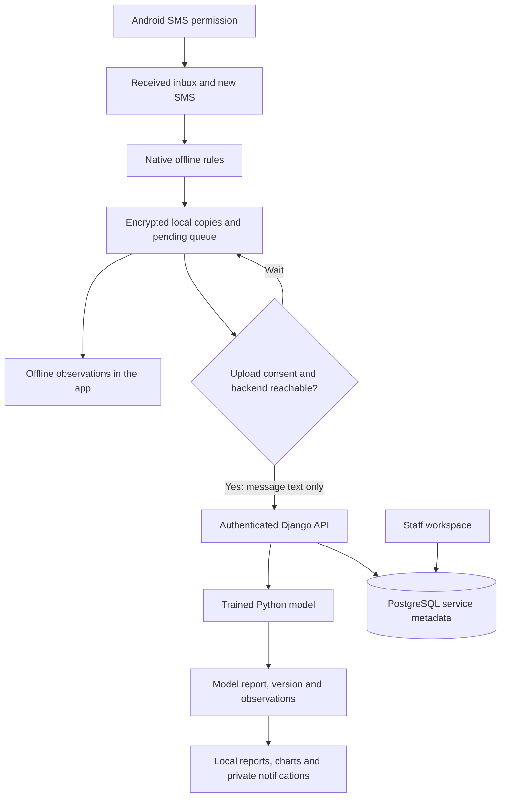

<p align="center">
  
</p>

<h1 align="center">SmishGuard</h1>
<p align="center"><strong>Understand the text. Spot the warning signs. Choose a safer next step.</strong></p>

<p align="center">
  
  
  
  
  
</p>

SmishGuard is an Android university capstone project for detecting **SMS phishing (smishing)**. With permission, it reads received SMS, groups conversations, produces immediate offline observations, and queues eligible messages for trained-model analysis when the backend is reachable. Results give a clear assessment, practical next steps, and supporting observations.

The mobile app uses **React Native, Expo and Kotlin**. A **Django REST Framework** backend runs the trained Python model locally, with **PostgreSQL** for service metadata. An optional encrypted device profile works without creating a server account.

> **Current status — 23 October 2026:** The Android development APK builds successfully and automated checks pass. Real-phone permission, inbox, notification and background acceptance checks remain pending. This is a capstone prototype, not a guarantee of protection or a production-certified security product. There is no demo/model selector or seeded SMS history.

## Contents

- [Features](#features)
- [How it works](#how-it-works)
- [Technology and repository](#technology-and-repository)
- [First-time developer setup](#first-time-developer-setup)
- [Daily startup and USB installation](#daily-startup-and-usb-installation)
- [App user manual](#app-user-manual)
- [Staff workspace and APIs](#staff-workspace-and-apis)
- [Privacy and security](#privacy-and-security)
- [Model and evaluation](#model-and-evaluation)
- [Testing and troubleshooting](#testing-and-troubleshooting)
- [Scope and documentation](#scope-and-documentation)

## Features

### SMS and detection

- **Real inbox import:** Received SMS grouped by sender, with an assessment for each message.
- **Existing and incoming labels:** New arrivals are distinguished from messages already present when protection was enabled.
- **Offline observations:** Local keyword and link rules work without the backend. These are explicitly labelled as rule-based findings, not trained-model results.
- **Automatic model reports:** Consented message text waits in an encrypted local queue and is checked by the backend when reachable. Failures retain the offline result and queue state.
- **Incoming-message handling:** Native Android broadcast handling, multipart reconciliation and background inbox reconciliation.
- **Private notifications:** Offline warnings and model-report summaries without exposing sender names or message bodies in notification content.
- **Manual checks:** Paste another message into Check to use the same offline/report workflow.

### Reports and controls

- Bold assessments, one recommended action, message previews and expandable observations.
- A bold Home dashboard with four metric cards, an interactive seven-day activity chart, animated recent conversations and pull-to-refresh.
- Completed-model risk counts and a seven-day report-completion chart, calculated from retained local reports.
- Permission setup, pause uploads, stop protection and local deletion controls.
- Optional **My profile** with an encrypted display name and unverified phone number; device-number lookup is permission-based, with manual entry as fallback.
- Offline safety lessons, quizzes, and an explicit refresh for staff-published lessons.
- A branded Django staff workspace for installation management, model metadata, lessons and existing consented feedback records.

## How it works



**Offline** means native rules and local reports remain available without the model service. **Model analysis** requires a reachable Django backend; the trained model is not inside the Android APK. With the current USB setup, a phone's internet connection alone cannot reach a laptop's loopback address.

Sender addresses stay on the phone. Message text can itself contain personal details, so automatic transmission is explained during setup and requires consent. The backend processes text transiently without saving SMS bodies in PostgreSQL.

## Technology and repository

- **Mobile:** React Native 0.88, Expo SDK 58 development builds, TypeScript, Expo Router, Reanimated, Zustand, TanStack Query, Manrope and Lucide.
- **Native Android:** Local Kotlin/Expo module, SMS provider and receiver, WorkManager, SQLite and Android Keystore AES-GCM encryption.
- **Backend:** Python 3.12, Django 5.2, Django REST Framework and Waitress.
- **Database:** PostgreSQL with separate provisioning, migration and restricted application credentials.
- **ML:** scikit-learn text pipelines, TF-IDF, calibration, Jupyter and a reusable local inference package.

```text
mobile/
  src/app/                       Screens and navigation
  src/components/                UI, report cards and charts
  src/services/                  Native bridge and API contracts
  modules/smishguard-sms/         Kotlin SMS, queue, encryption and profile code
  plugins/                       Persistent Android build/privacy configuration
  scripts/                       Windows Android and route-type helpers
backend/
  config/                        Django configuration
  service/                       Protected APIs, inference and staff operations
  scripts/                       Local database provisioning and verification
  openapi.json                   API contract
ml/
  smishguard_training.ipynb       Structured training and evaluation notebook
  smishguard_ml/                 Reusable training/inference package
  reports/                       Saved evaluation results
  MODEL_CARD.md                  Model evidence and limitations
docs/                            Setup, design decisions and handoff guides
PROJECT_BRIEF.md                  Living scope and documentation record
```

Generated Android/iOS folders, secrets, datasets, model binaries, APKs and virtual environments are excluded from Git. The repository is named **Smish-Gaurd**; the product name is **SmishGuard**.

## First-time developer setup

The commands below use **Windows PowerShell** from the repository root unless a directory change is shown. Other operating systems need equivalent environment and Android setup.

### 1. Prerequisites and clone

The tested workstation uses Python 3.12, Node.js 24/npm 11, Java 17, PostgreSQL 18 and the Android SDK. Install Android platform/build-tools 37, NDK 27.1.12297006, CMake 3.22.1 and platform-tools; accept the relevant SDK licenses. Set `JAVA_HOME` and `ANDROID_HOME`, and make `adb` available. Exact app dependencies are pinned in the package lockfiles and Python requirements.

Enable Developer options and USB debugging on the demonstration phone, and approve the computer's debugging prompt.

```powershell
git clone https://github.com/Danyal-0276/Smish-Gaurd.git
cd Smish-Gaurd
py -3.12 -m venv backend/.venv
.\backend\.venv\Scripts\python.exe -m pip install -r backend/requirements.txt
.\backend\.venv\Scripts\python.exe -m pip install -e ./ml
```

If `py -3.12` is unavailable, install Python 3.12 or invoke its executable explicitly. Keep the inference environment compatible with the evaluated model rather than using the workstation's default Python version blindly.

### 2. Configure and provision PostgreSQL

Create local environment files only if they do not already exist:

```powershell
if (!(Test-Path backend/.env)) { Copy-Item backend/.env.example backend/.env }
if (!(Test-Path mobile/.env)) { Copy-Item mobile/.env.example mobile/.env }
```

For a fresh local installation, edit `backend/.env` privately with the PostgreSQL administrator username/password and connection address. Use a dedicated local development server. Then run:

```powershell
.\backend\.venv\Scripts\python.exe backend/scripts/provision_local.py
```

This helper creates the project databases/roles, generates independent application secrets, changes the runtime configuration to the restricted `smishguard_app` role, and saves provisioning/migration/test credentials in separate ignored files. It refuses incompatible existing database ownership rather than silently replacing it. If it reports missing administrator credentials, edit `backend/.env.provisioning` privately as instructed. Do not use administrator database credentials in the running web service.

Apply migrations with the migration role, then return to normal runtime mode:

```powershell
$env:SG_DATABASE_MODE = 'migrate'
try {
    .\backend\.venv\Scripts\python.exe backend/manage.py migrate
} finally {
    Remove-Item Env:SG_DATABASE_MODE -ErrorAction SilentlyContinue
}
```

### 3. Supply the trained model

**A fresh clone does not include the trained bundle.** Obtain the trusted customer handoff or regenerate it using [the ML notebook instructions](ml/README.md). Put the selected bundle in `ml/artifacts/selected/`, including `model.joblib`, `metadata.json` and `requirements-inference.txt`.

Use only trusted artifacts: joblib files can execute code during loading. The service checks the expected model checksum/runtime and fails readiness when required files are missing or incompatible. No paid third-party model host is required.

With the bundle available:

```powershell
.\backend\.venv\Scripts\python.exe backend/manage.py seed_project
.\backend\.venv\Scripts\python.exe backend/manage.py create_local_admin
.\backend\.venv\Scripts\python.exe backend/manage.py check_readiness
```

The local staff credential handoff is saved to `.setup/backend-admin-credentials.txt` and is ignored by Git. Keep it private. [Backend guide](docs/BACKEND_GUIDE.md) and [model handoff](ml/BACKEND_INTEGRATION.md) provide more detail.

### 4. Install mobile dependencies and build

Set `mobile/.env` to the public local API address:

```dotenv
EXPO_PUBLIC_API_URL=http://127.0.0.1:8000
```

Every `EXPO_PUBLIC_*` value is visible to app users. Never put database passwords, staff credentials or private keys there.

```powershell
cd mobile
npm ci
npx expo prebuild --platform android --no-install
cd ..
```

Next, use the startup terminals below. Build/install the Android development client once after dependency or native-code changes. Expo Go and a browser cannot run this project's SMS module.

## Daily startup and USB installation

### Terminal 1 — backend, project root

```powershell
.\backend\.venv\Scripts\python.exe backend/serve.py
```

The server checks database/model readiness and binds to `http://127.0.0.1:8000`. Restart it after backend changes; this Waitress entry point does not hot reload.

### Terminal 2 — Metro

```powershell
cd mobile
npm run start:usb
```

After changing the API URL or clearing a stale bundle, use `npm run start:usb -- --clear` instead. This Windows helper uses an IPv4 loopback bundle URL, restores USB forwarding when one phone is connected, and refuses to start on an occupied port. Keep only one Metro instance running; mixing tunnel and localhost servers can break bundle/chunk loading.

### Terminal 3 — phone and build, project root

```powershell
adb devices
adb reverse tcp:8000 tcp:8000
adb reverse tcp:8081 tcp:8081
cd mobile
powershell -ExecutionPolicy Bypass -File .\scripts\android.ps1 --device --no-bundler
```

The script builds, installs and opens the development client. It applies this Windows project's Java temporary-path/Ninja setup; prefer it to a bare Gradle invocation on this workstation. Re-run Expo prebuild first after native configuration changes.

If a current APK already exists, install it from the project root without rebuilding:

```powershell
adb install -r .\mobile\android\app\build\outputs\apk\debug\app-debug.apk
```

This install command does not grant permissions or open the app. Open SmishGuard yourself and complete setup. If the development client remembers an old Wi-Fi/tunnel address, run `npm run open:usb` from `mobile/` after starting Metro. That command explicitly opens the app at the USB loopback URL and does not grant permissions. APKs are not included in the Git repository, so a fresh clone must build one first. Repeat USB forwarding after reconnecting the phone or restarting ADB.

**For use away from USB:** deploy the backend behind HTTPS and configure a reachable API URL in the app. This repository's local server is loopback-only. Public hosting and a release-signed, standalone APK have not been delivered.

## App user manual

### Start protection

1. Open SmishGuard and select **Get started**.
2. Read the SMS/privacy disclosure. Decide whether **Automatic model reports** may send eligible message text when connected.
3. Select **Allow SMS & start protection**, then approve Android's SMS permissions. Approve notifications if you want warnings and report summaries.
4. Review your real conversations on Home. Initial import covers the newest 200 received messages; **Load 200 older messages** imports another page, up to the local cap.

If access is denied, setup remains available through Settings. Android SMS permissions also depend on installer allowlisting; the app cannot bypass that restriction. Do not make it the default SMS handler as a workaround: this project is not a complete messaging app.

### Read a report

In **Reports**, search by sender, number or message text, then choose **All**, **High risk**, **Review** or **Low risk**. Filters combine across the latest 200 loaded reports and use the outcome shown on each card (model result when ready, otherwise offline findings). **Reset filters** restores the full recent list. Search stays on the phone.

Open a conversation or the **Reports** tab. Each message has its own outcome:

- **Offline check:** Immediate local observations. No matching rules does not mean the message is safe.
- **Model check queued:** Offline results are ready; the model request is waiting for a reachable service or a retry allowance.
- **Model report ready:** A trained-model assessment is available: low detected risk, review, or high phishing risk.
- **Code message / kept on this phone:** Detected OTP/code text is excluded from model uploads.
- **No model verdict:** The backend could not assess the text within its evaluated coverage; offline findings remain visible.

Read the short recommended action. Expand **Why this result** for observations and the model version. Expand the message preview for full text; detected links are not opened. A sender's conversation grouping is not a verified sender-reputation score.

The chart counts completed model reports over seven days. Risk counts describe retained assessments on this phone, not confirmed attacks, prevented losses or model accuracy.

### Check another message

Open **Check**, paste or enter text, and select **Check message** after protection setup. Offline rules run immediately; if automatic reports are enabled, eligible text joins the same queue. The app does not fall back to a simulated model verdict when the server is unavailable.

### Use the optional profile

Open **Settings → My profile**. Enter an optional display name and international-format phone number, such as `+923001234567`. **Use this phone's number** requests separate permission and tries an available carrier/SIM number; review it before saving. Some SIMs provide no number, so manual entry is supported.

Profiles are encrypted locally and are not attached to model requests or visible to staff. Numbers remain **unverified**. A saved number does not prove ownership or authenticate another SMS sender. **Delete profile** removes the profile independently of SMS reports.

### Control collection and data

- **Pause automatic uploads:** Stop future model submissions while retaining offline protection and pending copies.
- **Permissions & automatic reports:** Revisit setup and re-enable uploads with consent.
- **Stop SMS protection:** Disable new collection and automatic submissions.
- **Delete a local report / Delete all local reports:** Remove app copies and queued checks; original SMS messages remain in the system messaging app.
- **Android app settings:** Revoke SMS, number or notification permissions at the OS level.

A request already in transit cannot be recalled. Local copies expire after 30 days of retention, with a 5,000-message cap; cleanup runs when Android permits app/background execution. Force-stop and battery restrictions can delay processing. Reopening the app triggers reconciliation.

## Staff workspace and APIs

Open `http://127.0.0.1:8000/admin/` on the development computer. The staff workspace supports anonymous installation management/revocation, deployed-model metadata, lesson publishing and review of existing consented correction records. Staff authentication is separate from phone installation credentials. It is not an SMS inbox viewer or contact-management CRM.

The versioned API includes installation registration/rotation/revocation, transient message analysis, capabilities, published lessons and owner-scoped feedback. See [the OpenAPI contract](backend/openapi.json) for exact paths and schemas. API capability `automatic_sms=false` means the server itself cannot read a phone; `android_client_sms_queue=true` describes native client queue support.

Analysis defaults are **30 requests/minute and 300/day per installation**, with a global daily cap. Large inbox backlogs can therefore span multiple days. WorkManager retries respect server limits. Expired/revoked installation credentials pause automatic uploads and require setup again rather than silently bypassing revocation.

## Privacy and security

- SMS bodies/senders and optional profile fields are encrypted with Android Keystore-backed AES-GCM. The app disables backup and excludes private data from device transfer.
- Model requests send text and consent with an installation credential; they do not attach sender addresses, contacts, provider IDs or SIM identifiers. Message text itself may contain personal information.
- The backend does not save SMS bodies or use submitted texts to retrain automatically. Detected code messages remain local, but the English-text exclusion heuristic cannot recognize every secret or language.
- Each installation receives an independent bearer credential. PostgreSQL is accessed through the backend; database credentials never belong in frontend configuration.
- The API uses ownership checks, strict schemas, request limits, shared PostgreSQL quotas and bounded inference. Staff uses separate session/CSRF authentication. Production requires HTTPS and further operational validation.
- Logs, datasets, model artifacts, environment files, credentials and build output are excluded from Git. Keep real SMS and sensitive screenshots out of issues and pull requests.

These are implemented controls, not a certification or a substitute for device/security testing. See [the current protection guide](docs/SMS_PROTECTION.md) for exact behavior and remaining acceptance scenarios.

## Model and evaluation

The structured [training notebook](ml/smishguard_training.ipynb) compares Logistic Regression, Multinomial Naive Bayes and Linear SVM using grouped partitions and validation-based selection. The selected baseline is calibrated **Multinomial Naive Bayes** with fitted TF-IDF text features, deployed locally inside Django.

On the frozen historical test set of **1,160 messages**, the recorded model achieved **96.12% accuracy, 74.02% precision, 88.68% phishing recall and 3.13% false-positive rate**. The provisional 95% recall target was not met. These are benchmark results, not real-world protection rates, and false alarms/missed scams remain possible.

The dataset is Mishra and Soni's [Mendeley SMS dataset v1](https://data.mendeley.com/datasets/f45bkkt8pr/1), DOI `10.17632/f45bkkt8pr.1`, licensed CC BY 4.0. The source has 5,971 rows; cleaning leaves 5,797. The negative class combines ham and promotional spam, so this model is not a separate general-spam or phone-number-reputation classifier. Urdu, Arabic and WhatsApp performance are unvalidated.

See the [model card](ml/MODEL_CARD.md), [dataset card](ml/DATASET_CARD.md), [training setup](ml/README.md) and [backend handoff](ml/BACKEND_INTEGRATION.md) for reproducibility, attribution and limitations. Dataset licensing does not automatically license this repository's application code; no additional application-code license is declared here.

## Testing and troubleshooting

### Automated checks

```powershell
cd mobile
npm run check
npm run lint
cd ..
$env:SG_DATABASE_MODE = 'test'
try {
    .\backend\.venv\Scripts\python.exe backend/manage.py test config service --keepdb --noinput
} finally {
    Remove-Item Env:SG_DATABASE_MODE -ErrorAction SilentlyContinue
}
```

The dedicated test database must already exist. Native rule/endpoint/profile tests run through `:smishguard-sms:testDebugUnitTest` with the project's Windows Gradle temporary-path setup.

Recorded verification for Android 0.2.0: **6 native tests, 14 JavaScript tests and 23 backend tests passed**, along with TypeScript, ESLint and the arm64 development APK build. This is a dated snapshot, not a live CI badge. [Verification evidence](docs/setup/sms-verification.json) lists phone acceptance scenarios still pending.

### Common problems

- **The app shows old sample screens or says the native SMS module is missing:** Install the newly rebuilt development APK. Reloading Metro cannot add Kotlin modules or manifest permissions.
- **No SMS permission prompt:** Use protection setup in the rebuilt app. Review Android App info → Permissions; installer restrictions may prevent SMS approval.
- **Messages remain queued:** Keep Django running, check USB forwarding for port 8000, confirm the API URL and upload consent, and allow for connectivity, quotas and Android scheduling. No internet service can reach a laptop's loopback address without the configured bridge.
- **The UI cannot load:** Keep Metro running and reverse port 8081. Accept the USB debugging prompt and verify the phone appears as `device` in `adb devices`.
- **Backend readiness fails:** Check PostgreSQL, generated runtime secrets/roles, migrations, the trusted selected model files and `seed_project`. The server intentionally refuses to start with a missing or incompatible model.
- **A phone number cannot be detected:** Enter it manually. Carrier-provided numbers are optional and unverified.
- **Background alerts are delayed:** Check permissions and battery restrictions. Force-stopped apps do not provide uninterrupted protection; reopen and refresh.
- **A Windows native build fails:** Use `scripts/android.ps1`, which prepares the pinned Ninja and short Java temporary path. Read the first actual compiler/build error; Gradle deprecation notices alone do not identify the failure.

## Scope and documentation

This delivery targets an **Android university demonstration**. It does not read private WhatsApp chat databases, verify sender authenticity, block/quarantine system SMS, run the trained model fully on-device, or provide a production deployment. Public Play distribution has additional SMS-permission policies. Release signing, a standalone customer APK, HTTPS hosting, load/security validation and verified ownership/reputation services remain separate work.

- [Living project brief](PROJECT_BRIEF.md) — scope and decisions for the documentation collaborator.
- [Current SMS protection guide](docs/SMS_PROTECTION.md) — authoritative native workflow, privacy boundaries and acceptance checklist.
- [Client progress update](docs/CLIENT_UPDATE.md) — shareable implementation status.
- [Backend guide](docs/BACKEND_GUIDE.md) — database roles, APIs, staff operations and runtime details.
- [ML workspace](ml/README.md) — dataset download, training and export.
- [Earlier roadmap](docs/BACKEND_ROADMAP.md) — design history and future milestones; current guides supersede older status descriptions.

When contributing, keep the notebook evaluation, documentation and actual implementation consistent. Separate measured results from targets, preserve original reference documents, and never commit credentials, private SMS, database dumps or signing keys.
