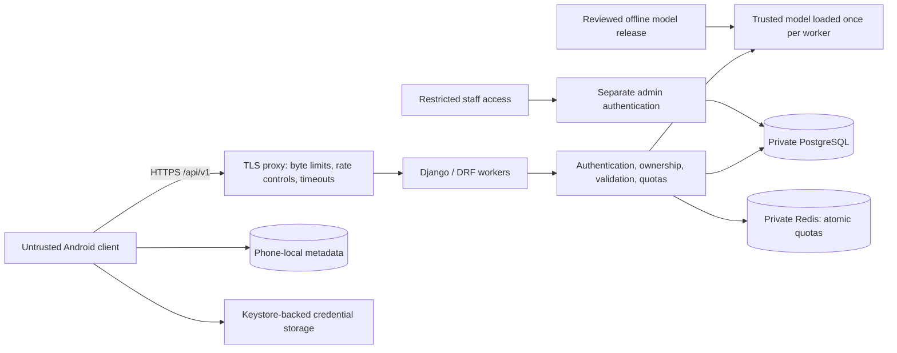

# SmishGuard: secure backend and next implementation steps

Updated 22 October 2026. This is the next implementation plan, not a claim that its APIs or security controls already exist. It extends PROJECT_BRIEF.md and the existing frontend/model handoffs. Android APK demonstration remains the delivery target. The app stays stopped during this planning work.

## 1. Current position and immediate priorities

Implemented: React Native/Expo frontend, synthetic checks, local metadata history, lessons/quizzes, blue/black/white/yellow design, original shield/S logo, reduced-motion-aware floating dock and transitions; evaluated Python model bundle; Django/DRF foundation. Not implemented: installation authentication, business APIs, live inference integration, native incoming-SMS screening, or production deployment.

The local PostgreSQL credentials in backend/.env authenticated successfully using read-only queries. Both pgAdmin connections use `postgres`; the only matching database role among `postgres` and `danyal` was `postgres`. The password was not printed, copied into documentation, reset, or changed. `smishguard_dev` does not yet exist. No database/schema/role was created during this review.

The local server binds all interfaces (`listen_addresses=*`), uses SCRAM authentication, and has SSL disabled. Its current host authentication rules permit loopback addresses only. This does **not** establish that the database is internet-accessible; Windows/network firewall exposure was not audited. The application currently points at the PostgreSQL superuser, which is suitable only for deliberate provisioning, not the eventual Django runtime. Do not alter this shared laptop server globally without considering other projects.

Priorities, in order: secure database roles and configuration; installation isolation; model-backed manual scanning; native feasibility; complete privacy/error behavior; acceptance/security/load tests; standalone APK and handoff. Prove native feasibility early in parallel with the design work so the capstone does not depend on an untested Android capability.

## 2. Recommended product scope

An additional discussion about selected existing-SMS scans and optional WhatsApp notification previews is recorded in [the platform feasibility note](decisions/0002-sms-and-whatsapp-feasibility.md). These expand the original baseline and are candidates pending a real-phone permission/coverage test; they are not implemented or automatically approved for bulk cloud upload.

### First useful release

- **Real message checks:** paste a text, explicitly choose online processing, and receive the trained model's assessment with observed indicators, version, and practical next steps.
- **Explain the warning:** distinguish suspicious wording/link structure from actual model attribution. No invented confidence, verified-bank identity, or website-safety claim.
- **Privacy center:** cloud consent, history controls, 30-day default metadata retention, clear-local-data, installation reset, and a plain explanation of what leaves the phone.
- **Protection diagnostics:** separate manual checks, local incoming-message warnings, network availability, permissions, and model availability. Never use one unconditional “protected” badge.
- **Share-to-check:** accept shared text from compatible apps, let the person review it, then submit deliberately. Paste remains the fallback.
- **Metadata-only history:** filter/search dates and risk, show analysis mode/model version, and retain no message body, sender number, or full URL by default.
- **Local incoming-SMS warnings:** native rules and privacy-conscious notifications, after testing the actual phone. Warn alongside the existing SMS app; do not claim to block/delete system messages.
- **Safety lab:** a labelled synthetic scenario pack—delivery fee, account pressure, prize, and ordinary text—with a short “what would you do?” explanation. This extends the existing samples and quizzes without collecting live messages.
- **Contextual learning:** suggest the relevant short lesson from a result; keep progress local. Existing four lessons remain the starting point.
- **Offline honesty:** a limited local-rules result has a distinct mode. Network failures and unsupported inputs never become “low risk.”

### Useful second phase

Biometric app lock, metadata-only export through an explicit share action, reviewed lesson updates, opt-in metadata feedback, and a protection diagnostic checklist. Keep biometric enforcement native; secure device access is not a cloud account.

Defer raw-message donation, inbox import, default-SMS/quarantine duties, remote URL crawling, automatic retraining, and fully offline ML. Urdu/Arabic/Roman Urdu support needs evaluated data and explicit scope; the existing model provides no validated performance claim for them.

## 3. Trust boundaries and deployment

The mobile app contains an API base URL, never a PostgreSQL connection string, database password, Django secret, or quota-signing secret. An API URL is public information, not a security boundary.

Only the TLS API port is exposed to clients. PostgreSQL and Redis bind to a private interface/network and accept only the backend's permitted sources. Never forward database port 5432 to the phone or put it in a public container port mapping. On a single-host development setup, keep database access on loopback. Use database TLS with verified certificates where the database crosses hosts or the deployment requires it.

Django is a modular monolith initially: `installations`, `analysis`, `content`, and `operations`; add `feedback` only when enabled. Each module has views/serializers, application services, and explicit persistence boundaries. Avoid generic CRUD endpoints exposing every model. Separate development, test, and deployment settings. Production uses a supported WSGI/ASGI server behind the proxy, not `runserver`.

CORS restricts browser origins, not native clients or curl. TLS, credentials, per-endpoint permissions, owner-scoped queries, and network restrictions provide the actual controls. A rooted/compromised phone can expose its own credential; the design limits the resulting authority rather than promising an untouchable mobile secret.

## 4. Database privileges and data model

Provision the project database deliberately using the existing administrator connection. Then create separate, generated credentials kept out of Git:

- `smishguard_migrator`: owns the project's schema/objects and runs controlled migrations; no cluster administration or superuser privileges. Do not use it for serving requests.
- `smishguard_app`: runtime login with required table CRUD and sequence permissions only, no schema creation, role/database creation, or superuser rights. Revoke PUBLIC schema creation for the project database and set future-object grants under the correct migration owner. Test that the application cannot create/drop tables.
- Test database and credentials are separate. Migration credentials belong to the deploy process, not running mobile/API containers. PostgreSQL superuser credentials are removed from the final runtime environment.

PostgreSQL grants are additive: revoking a role's explicit CONNECT grant does not override a CONNECT privilege inherited through PUBLIC. For strict isolation on a shared laptop cluster, choose a separate project instance or review role-specific database allow/deny rules in `pg_hba.conf`; do not revoke other projects' PUBLIC access or change shared server rules blindly. Production should have a dedicated service boundary, and cross-database access tests must reflect the actual grants/authentication rules.

Planned entities:

- **Installation:** random UUID, created/revoked timestamps, minimal client compatibility metadata. No owner phone number, SIM serial, contacts, IMEI, IMSI, or advertising ID.
- **InstallationCredential:** public lookup identifier, installation FK, keyed verifier, verifier-key version, expiry/revocation timestamps. Unique lookup ID, indexed installation FK. Never store the usable credential.
- **ModelRelease:** immutable version, trusted artifact checksum, runtime compatibility, decision-policy version, evaluation metadata, activation state. No arbitrary remote model upload/loading through the public API.
- **RuleRelease:** reviewed local-rule manifest, compatibility, version, and expiry. Baseline ships rules with the signed APK; authenticated/signed remote updates are later work.
- **LessonVersion:** reviewed content, stable slug, publication status, revision, and timestamps. Public reads exclude drafts and staff fields.
- **AdminAuditEvent:** actor, action, release/content identifier, timestamp, sanitized change metadata. No SMS/token/request payload.
- **FeedbackEvent, optional:** installation FK, client-generated event UUID, verdict/mode/model version, correction reason enum, created/deleted status. Unique `(installation_id, client_event_id)` and ownership index. No raw text or URL. Only explicit consent permits upload.

There is deliberately no central SMS inbox or normal server-side scan-history table. Ordinary bodies/results are processed transiently; durable history lives on the phone. Store no deterministic message hash as an analytics shortcut—it can still identify known messages. PostgreSQL RLS is optional defense in depth, not a substitute for tested application ownership; if introduced, handle connection-pool tenant context and table-owner bypass explicitly.

## 5. No signup; installation authentication instead

1. First online use requires cloud-processing consent. Register a fresh installation over HTTPS. Bootstrap cannot claim an existing installation or choose its owner ID.
2. Generate 256 bits of random credential secret server-side. Return its public lookup ID and secret once, with an expiry. Proposed initial credential lifetime: 90 days; tune before release.
3. Store the secret using a compatible Keystore-backed SecureStore integration, excluded from backups and logs. Do not place it in Zustand, SQLite, ordinary preferences, or an Expo public environment variable.
4. Store a keyed HMAC-SHA-256 verifier server-side using an independent protected pepper, a key version, and constant-time comparison. The public lookup ID narrows lookup; it grants no access. Maintain pepper rotation/retirement explicitly.
5. Every protected request resolves an installation principal from the credential. The client never supplies authoritative `installation_id`, role, `is_staff`, or owner fields in its JSON. Reject unexpected fields.
6. Revocation and expiry take effect server-side. Rotation issues a new secret and revokes the old one in a transaction. If the response is lost, the simple baseline re-registers; local history remains and there is no cloud-history recovery promise. Avoid retaining raw credentials to make retries convenient.
7. Installation credentials cannot authenticate to Django Admin. Staff use a separate authenticated session, CSRF protection, least privilege, and deployment-appropriate MFA/network restrictions.

An embedded global APK key is not authentication. Anonymous bootstrap can be called by scripts; quotas, edge controls, a global service budget, and optionally evaluated Android attestation reduce abuse. Do not claim that only genuine APKs can call a public endpoint. Attestation is not mandatory for the university APK and must not require a paid/store-dependent workflow without a separate decision.

## 6. Proposed versioned API contract

Baseline paths and access rules:

- `POST /api/v1/installations`: narrowly scoped unauthenticated bootstrap; strict byte/schema limits, IP/global quotas, fresh random identity only. Returns one-time credential; `Cache-Control: no-store`.
- `POST /api/v1/installations/me/credentials/rotate`: current installation credential required; no arbitrary installation ID; atomic revocation/issuance; no-store response.
- `DELETE /api/v1/installations/me`: revoke installation credentials and delete/expire eligible owned metadata. Clear client-held credential after confirmation. Document audit/backup retention separately.
- `POST /api/v1/analyses`: installation authentication, online consent enforced by the app, strict input schema, atomic inference quotas and bounded concurrency. No server scan-list/detail endpoint. Return transient assessment only; no-store response.
- `GET /api/v1/capabilities`: bounded public, cached compatibility information: accepted input size, declared model coverage, supported modes, service/version availability. No infrastructure secrets or server paths.
- `GET /api/v1/lessons` and `GET /api/v1/lessons/{slug}`: public published content, explicit fields, revision/ETag caching, bounded pagination (default 20, maximum 50), no draft access. Local bundled lessons provide a fallback.
- `GET /health/`: minimal public process liveness. A separate restricted readiness probe checks required dependencies and model readiness; public errors do not enumerate internal failures.
- Later `POST /api/v1/feedback`, `GET /api/v1/feedback/me`, and `DELETE /api/v1/feedback/me/{id}`: installation-scoped metadata only, explicit upload consent, bounded pagination, ownership on **every** query/reference. Return indistinguishable 404 for another installation's object.

Analysis input: JSON object containing `text` only initially, 1–5,000 Unicode characters after an empty/whitespace check; preserve actual submitted text for the model. No arbitrary sender ID, callback URL, artifact path, owner ID, or remote destination. Reject non-string, null, array, nested-object and unknown fields. Proxy and app enforce a 32 KiB request-body limit, supported content type, maximum work, and controlled error responses. Byte limits and character limits are different controls.

Analysis output is an explicit discriminated contract, not a dump of internal objects:

- Completed: request UUID, `status=completed`, `mode=backend_model`, risk `low|review|high`, observed indicators, extracted domain labels (inert), approved advice, model/policy versions, and validated coverage notice. Include model estimate only if its meaning is clearly explained; never call it a certainty or prevention score.
- Unsupported/insufficient input: `status=unsupported`, risk and estimate absent/null, coverage reason and practical next step. This can be a successful HTTP response describing an abstention; validation failures still return 400.
- Failures: stable `{error:{code,message,request_id}}`, no Python trace/SQL/model path/token/body echo. Use 401 for missing/expired/revoked credentials, 403 for authenticated-but-disallowed operations, 404 for hidden/not-found owned resources, 413 for body size, 415 for content type, 429 plus Retry-After for quota, and 503 for unavailable model/required guard dependency.

Validation errors must not echo rejected text in logs or error representations. URL extraction is local parsing only; no redirects, HTTP requests, DNS reputation checks, previews, or WebView rendering. This removes an unnecessary SSRF and privacy boundary from the first release. Render server strings as text, never injected HTML.

Generate an OpenAPI schema and typed mobile contract as implementation starts. The current `ScanResult.mode='demo'` union must be extended deliberately; do not silently substitute model output into the mock shape. Demo is an explicit user-visible environment/mode, never the automatic fallback for a failed backend request.

## 7. Request protection and capacity controls

Public deployment needs a TLS proxy plus a private shared Redis instance for atomic quotas; this is a demonstrated need for shared guards across workers, not a reason to add Celery or microservices. Keep Redis bound privately with ACLs/credentials and transport protection appropriate to its network.

Starting quota proposals (configurable and unmeasured): registration burst 5 and 20/hour per trusted client-IP key; analyses 30/minute and 300/day per installation; explicit global inference/registration budgets and a bounded worker-concurrency cap. Shared university Wi-Fi can put many people behind one IP, so measure the registration limit in the demo and tune it. Client-provided forwarding headers are ignored unless set by the configured trusted proxy.

Use an atomic Redis operation/script that checks all relevant counters and increments only if the request is admitted. Expiring, privacy-minimized keys; no message text, raw credential, or full URL in key names. Define 429 behavior under concurrency and across two workers. Basic DRF throttle classes alone are not a DDoS defense and may use non-atomic counters. If the required shared quota store fails, protected analysis/bootstrap fail closed with a controlled 503; never silently switch to an unbounded per-worker cache. Public static lessons may remain available independently.

The edge limits connection/request rates, upload bytes, and request/header timeouts before expensive parsing. The API enforces credential validity, schema, quotas and bounded inference work. Account for load arriving at unauthenticated routes, invalid-credential lookups and staff login separately. Apply resource limits at the worker/server as well as Python code; cancelling a client request does not necessarily stop a running CPU task.

Deployment configuration: DEBUG=False, explicit allowed hosts/origins, secure staff cookies and CSRF, HTTPS redirects/HSTS only after TLS is correctly configured, trusted proxy headers configured explicitly, no public debug/admin browsable endpoints or model directories, secrets outside source control, restricted runtime filesystem, and reviewed pinned dependency updates. Do not apply production HTTPS settings blindly to the USB localhost demonstration.

## 8. Model execution and scale path

Keep the trained model inside the backend deployment. No separate paid model host is needed. Load the trusted selected bundle once per worker, verify its checksum/runtime compatibility, and mark that worker unready if it cannot load. Offline release/review controls who can change the bundle; a checksum alone does not make an attacker-supplied pickle safe. Do not accept model files from phone clients.

The existing `SmishGuardPredictor` already returns abstention, calibrated model estimate, versions, and a few observed indicators. Add a service adapter mapping its verdict strings to the API contract. Never alter the frozen test thresholds silently. Its script guard is not a reliable language detector; retain that limitation in the product and tests.

Start with bounded synchronous requests and a small measured worker count. Each worker has its own model-memory footprint; cap numerical-library threads to avoid CPU oversubscription. Do not train models in request handlers. Do not enqueue raw SMS bodies into a task broker to make inference “asynchronous.”

Scale in stages: measure single-instance latency/memory; add API workers/replicas behind the proxy while sharing PostgreSQL and quota state; budget database connections per worker; add a pooler if measured connection demand needs it; cache only shared lesson/capability content. Private analysis responses are never globally cached. Split model serving or introduce a worker queue only for a measured bottleneck and an approved message-retention design.

Record request count, duration buckets, controlled error classes, model version, and aggregate quota rejections. No payload logging, request/response-body tracing, token dumps, sender values, or full query/URL logging. Configure the proxy, Django error reporter, APM and crash tooling—not only application log calls. Set and test explicit security-log retention before enabling collection. Do not claim “zero personal data” when infrastructure still processes IP addresses.

Performance gates are experiments, not capacity promises: start with 1, 5, 10, and 25 concurrent clients and measure warm/cold p50/p95 latency, memory, DB connections, errors and limiter behavior on named hardware. Preserve the provisional user-facing 3-second objective only if measured end-to-end results support it. Check overload rejection instead of increasing concurrency without limits.

## 9. Android behavior and frontend polish

Manual model checks are the first end-to-end slice. Cloud consent occurs before transmitting text, and declining leaves local lessons/history usable. Network permission alone is not consent. Never automatically upload an offline backlog.

Native feasibility uses the intended phone: verify multipart assembly, duplicate events, locked screen, background process, permission revocation, offline state, notification denial, and force-stop limitations. Read only new incoming events for the selected feature; do not request inbox/contact/SIM access to identify a user. Request only permissions justified by the tested native implementation. A sideloaded APK does not bypass Android permission/background rules. Preserve normal delivery to the existing SMS app.

For the first native milestone, run lightweight local rules and emit a metadata-only warning. Full server ML remains user-triggered from the app. **Do not put raw SMS into WorkManager input, intents destined for exported components, logs, or a durable retry queue.** A killed-process notification cannot promise to reconstruct a message that was never persisted. Open its retained metadata and ask the user to paste/share text again when needed.

Automatic cloud screening is a separate later decision: explicit independent consent, a carefully designed encrypted short-lived spool if persistence is unavoidable, Keystore keys, bounded lifetime/deletion, and no raw body in WorkManager data. Do not quietly weaken the default no-body-retention rule to make background delivery easier.

Current motion already includes the floating dock's moving selection, tab fades, upward screen entrances, splash reveal, and a finite demo-check progress line. Keep the approved logo and minimal layout. Next polish should make state changes understandable: short result reveals, quiz-feedback fades, and permission-step completion; respect app and OS reduced-motion settings throughout. For real requests, replace the demo's timed progress with an indeterminate state tied to the request—never invent percentage completion. Avoid looping scanner theatrics or red alert pulses.

## 10. Delivery sequence and acceptance gates

### Milestone 0 — architecture and native feasibility

Finalize this plan, API modes, English-oriented baseline, intended phone/Android version, and what “defend” means. Rebuild/inspect the current icon/dock/splash on that phone without treating a compile as runtime proof. Run a small native receiving/notification feasibility experiment before promising automatic screening. Gate: written supported/unsupported behavior and permission evidence.

### Milestone 1 — secure foundation

Create isolated project/test databases; provision migrator/runtime roles and grants; split settings; implement installation credentials, expiry, rotation, revocation and scoped principals; add request IDs, redaction and shared quota guards. Gate: no mobile database secret, runtime cannot run DDL, invalid credentials fail closed, two-installation tests pass, deployment checks run against the correct settings.

### Milestone 2 — real manual analysis

Implement schema/OpenAPI, model service, modes/abstention/error contracts, consent, Keystore-backed storage, and the typed frontend API adapter. Gate: a pasted message uses the actual selected backend model, failures never display a fake low-risk result, and raw text is absent from database/logs/cache/backups. Smoke-test model/version consistency and bounded work.

### Milestone 3 — phone-native value

Add share-to-check and the tested local incoming-message warning path. Gate: multipart, deduplication, revoked permissions, background/locked screen and notification-denied cases are documented; ordinary SMS delivery continues; no unconsented cloud uploads or hidden raw-message queue.

### Milestone 4 — complete the experience

Add real diagnostics/consent controls, metadata retention, contextual lessons, safety-lab examples, error/retry UX, and the small motion refinements above. Optional feedback remains disabled until its consent/ownership/deletion tests pass. Gate: screen-reader labels, reduced motion, keyboard/dock clearance, offline/timeout states and deletion behavior tested on phone.

### Milestone 5 — evidence and customer delivery

Run security/load/usability tests, review dependency advisories, produce a standalone signed/internal APK without Metro, verify clean-device installation, and prepare source/setup/model provenance/test results/report handoff. Signing keys and deployment secrets remain outside Git. Gate: reproducible build, measured limits/limitations, restore procedure, and no unsupported “prevents all phishing” claims.

## 11. Required security and failure tests

- Installation A cannot list/read/update/delete or infer B's feedback records by substituting UUIDs, owner fields, nested references, or pagination parameters. Test list filtering and creation references, not just object permission hooks.
- Missing, malformed, expired, revoked and rotated tokens fail; installation tokens never gain staff access; registration cannot adopt an old installation.
- Concurrent quota calls across two workers respect the configured budget; unavailable Redis denies protected work; forged proxy headers cannot escape the intended limiter key.
- Empty, oversized, escaped-large-byte, invalid JSON, wrong-type, unknown-field, unsupported-text and URL-heavy inputs receive controlled bounded responses. Links are not fetched.
- Canary SMS/credential strings do not appear in DB rows, Redis values, proxy/application/APM/error logs, local metadata, notification previews, or test artifacts. Use synthetic canaries, never real messages/passwords.
- A missing/tampered/incompatible model, timeout, network loss or quota rejection cannot result in a low-risk label or a silent demo substitute.
- Runtime database login cannot create/drop tables/roles or access another project database. Credentials are absent from APK JS/assets and public repository history; the phone cannot reach the database network port in the intended deployment.
- Staff login, CSRF, role boundaries, release activation/rollback and audit redaction are checked independently from mobile installation auth.
- Data deletion/revocation and retention jobs work on owned data, with separately documented audit/backup limits. Feedback never automatically retrains or blacklists anyone.

## 12. Primary implementation references

- [Django deployment checklist](https://docs.djangoproject.com/en/5.2/howto/deployment/checklist/)
- [DRF permissions: object/list/create limitations](https://www.django-rest-framework.org/api-guide/permissions/)
- [DRF throttling limitations](https://www.django-rest-framework.org/api-guide/throttling/)
- [OWASP REST security](https://cheatsheetseries.owasp.org/cheatsheets/REST_Security_Cheat_Sheet.html)
- [OWASP Django REST Framework guidance](https://cheatsheetseries.owasp.org/cheatsheets/Django_REST_Framework_Cheat_Sheet.html)
- [Expo SecureStore](https://docs.expo.dev/versions/latest/sdk/securestore/)
- [Android SMS intents](https://developer.android.com/reference/android/provider/Telephony.Sms.Intents)

These references support control/platform choices; they do not establish that the planned features have been implemented or that the current code is production-ready.
