# Weightminer requirements review and proposed system design

Historical review retained under the original working name. On 22 October 2026, the working app name became SmishGuard and the stack/access-control choices were updated. See [the current project brief](../../PROJECT_BRIEF.md), which supersedes provisional choices in this review. Original sources now live in `../references/`.

Prepared 22 October 2026. This is a discussion draft, not an approved specification or an implementation. Delivery target confirmed by the client-facing developer: an Android APK for a university demonstration. The selected scope is SMS phishing detection and defense. Message languages and technology constraints remain pending.

## 1. Findings from every supplied file

### Filled Capstone Idea Submission Form.docx

The form proposes **AI-Based Phishing Email Detection and Cybersecurity Awareness System**, with a web interface for pasted or uploaded email, three comparison algorithms, prediction scores, explanations, and evaluation metrics. It is dated 8 September 2026 for Fall 2026, academic year 2026–2027. Student identities, supervisor endorsement, and chair approval are blank; the file itself does not establish signed approval. It contains no Weightminer title.

Retain the AI-driven cybersecurity motivation, awareness component, evaluation approach, and relevant UAE/SDG alignment. Rewrite the title, abstract, user population, inputs, delivery platform, and impact statements around mobile SMS. The selected mobile scope is confirmed in our discussion; supervisor acceptance is not evidenced by this form.

### Capstone_Chapter_1_and_2_reformatted.docx

Despite its filename and cover, the body contains Chapter 1 and references, not a completed Chapter 2. It defines an email-only web prototype and explicitly excludes SMS from the current scope. Useful material includes model comparisons, warning indicators, and measurement definitions. Its email statistics and commercial-email comparisons should not be presented as evidence of SMS detection performance.

The TF-IDF description needs correction: inverse document frequency reduces the weight of terms common across many documents. The existing sentence describes that relationship incorrectly. The discussion of a score as a probability also needs calibration and uncertainty qualifications. Bibliographic and statistical claims need a separate primary-source audit before reuse in a submitted report; they were not adopted as verified SMS evidence here.

### Chapter 2.docx

Defines MR1–MR9 and ER1–ER13 for the email web prototype. Requirements include results within three seconds for 5,000 characters, three labels, 95% accuracy, 95% phishing recall, at most 5% false positives, explanations, confidence scores, three algorithms, browser compatibility, and no retained email content.

These are draft targets and design requirements, not measured achievements. Browser compatibility and email-file upload must be replaced. No-content retention must be reconciled explicitly with mobile history and feedback. Appendix A is a proposed questionnaire with a suggested sample; no completed responses or raw survey results were supplied. We should collect genuine SMS-user input before describing those needs as validated research.

### BCS_Capstone Project Manual_01072026.docx

The university expects requirements traceability, competing-system analysis, general and detailed architecture diagrams, UML or suitable notation, WBS, Gantt chart, cost estimates, implementation evidence, testing, evaluation, and individual contributions. The report has six chapters: introduction, requirements, design, implementation, testing/evaluation, and conclusion/future work.

Its assessment schedule places proposal work in week 3, analysis/design in week 7, progress work in week 10, implementation/testing in week 13, final report in week 15, and presentation in week 16. These are semester-relative guidance, not confirmed calendar deadlines for this client. The guide is labelled 2025–2026, whereas the filled proposal is 2026–2027. Confirm the current course instructions. Some rubric totals and program labels are internally inconsistent, so use the supervisor's current rubric for final submission requirements.

### CS0-0480 Capstone Project Syllabus 01072026.docx

Not a Word document: its bytes contain an HTML page titled **Log in to the site | FU LMS**. It supplies no usable syllabus requirements. Obtain the actual downloaded syllabus later; the readable manual supports provisional planning now.

### WhatsApp Image 2026-10-22 at 3.22.57 PM.jpeg

A photograph of a cybersecurity project-idea list. The marked entry is **Build a mobile app that detects and defends against SMS phishing attacks**. This supports the chosen concept but specifies no platform, language, detection algorithm, blocking mechanism, or project name.

The review covered extracted document text, tables in document order, available header/footer/notes content, and the nine embedded figures as well as the supplied photograph. It was a content and requirements review, not a print-layout audit. Original supplied files were preserved.

## 2. Recommended product definition

**Weightminer is an Android prototype that assesses SMS messages for phishing risk, explains the warning signs, and helps users avoid acting on scams.** For the university APK, aim to demonstrate both user-initiated scans and incoming-message assessment on the chosen test phone.

Its academic contribution should be an evaluated detection pipeline plus a usable protective workflow. A large collection of screens, a chatbot, or a claimed accuracy percentage does not establish that contribution.

Treat Weightminer as the working name supplied in conversation. No supplied file defines that name. Message-language coverage remains undecided. English can support an initial dataset experiment, but is not a confirmed product requirement. Arabic or other languages require their own data, evaluation, normalization decisions, and UI considerations.

### Protection boundary

- Detection: assess message content and link characteristics.
- Explanation: show specific observed indicators and uncertainty.
- Defense in the app: keep message links inactive by default, show a warning before any external navigation, avoid link previews, and offer practical verification steps.
- Incoming-message warnings: attempt through a native Android integration after permissions and lifecycle feasibility testing.
- Quarantine or control over SMS storage/delivery: separate scope requiring the appropriate default-SMS-app role and full handler responsibilities.

An observer app cannot promise to stop another SMS app from displaying a message or opening a link. A hidden item in Weightminer's own history is not system quarantine. Sender names and phone numbers are not authenticated identities, and a trusted-sender preference must not override strong phishing evidence.

Google Play publication is outside the confirmed delivery scope. Its SMS permission policy still matters for a later release, but should not be mistaken for a prohibition on all university device experiments. Sideloading also does not bypass Android permissions, installer restrictions, or background execution rules.

## 3. Proposed features and release boundaries

### Essential demonstration scope

1. **Clear onboarding and consent.** Explain local checks, optional server analysis, SMS access, notification access, and the limits of protection. Show whether automatic protection is active, unavailable, or disabled.
2. **Paste a message to scan.** Allow optional sender context and manual review before submission. The app remains useful when SMS permission is declined.
3. **Receive shared message text.** Support Android share intents where the source SMS application supplies text. Keep paste available because source-app behavior varies.
4. **Scan incoming SMS.** Native Android receiver, multipart assembly, deduplication, local screening, and warning workflow, contingent on the device feasibility gate. Request only necessary permissions; reading historical SMS is a separate capability.
5. **Risk result with reasons.** Present low detected risk, suspicious, or high phishing risk, with a suitable next step. Low detected risk is not a guarantee of safety.
6. **Link inspection without browsing.** Extract domains, identify observable anomalies, and keep the original destination visible without loading it. A shortened URL or HTTPS alone does not prove phishing or legitimacy.
7. **Privacy-conscious history.** Store scan metadata locally by default; show time, result, analysis mode, and version. Full message saving requires a separate scope/retention decision.
8. **User corrections.** Allow a local disagreement with a result. Submitting content to the research team is a distinct opt-in action.
9. **Contextual education.** Explain the relevant scam pattern and advise verification using an independently known channel. Use reviewed, authored guidance.
10. **Settings and deletion.** Control cloud analysis, local history, notifications, and permissions; clear app-held records.

### Useful additions after the core works

- Short lessons and a small quiz, with local progress.
- Curated domain indicators with source, expiry, and administrator review.
- Signed or otherwise authenticated model/rule version updates.
- Local encrypted saved-message history, if requested and reconciled with the revised privacy requirement.
- A lightweight on-device ML model after memory, latency, and parity evaluation.
- Arabic or other language support after data feasibility is established.

### Separate scope rather than implied capabilities

Full SMS inbox replacement and quarantine, automatic deletion, iOS filtering, RCS/WhatsApp/email scanning, screenshot OCR, website crawling, global browser blocking, live commercial threat feeds, and automatic model retraining. These add distinct technical and evaluation work. A generative AI chatbot is not needed for the initial system.

## 4. Mobile frontend responsibilities

React Native with TypeScript is a reasonable provisional UI choice. Automatic SMS integration will also require native Android work, likely Kotlin. A custom development build or native build is required for native modules absent from Expo Go. This is a stack feasibility point, not a final technology commitment.

Suggested screens are responsibilities to discuss, not approved visual designs:

- **Onboarding:** purpose, consent, SMS/notification permissions, fallback behavior.
- **Home:** accurate protection status, manual-scan entry, recent local result counts, limitations when offline or permission is missing.
- **Scan:** editable message text, optional sender, explicit submission, input validation, analysis state.
- **Result:** verdict, model estimate when available, observed reasons, link/domain details, advice, mode/version, correction action.
- **History:** local metadata list, deletion, and rescanning only when text is available or re-entered.
- **Learn:** brief lessons; quizzes only if included in the agreed scope.
- **Settings:** cloud consent, notifications, history retention, permissions, supported languages, privacy explanation.

Recommended flow: open/paste or share → assess → understand result and act. Do not require account registration to scan. Loading, API timeout, offline, unsupported language, and empty input need explicit states. A scan error must never look like a safe result.

Keep raw SMS out of analytics, crash logs, notification previews, and persisted UI state. Android native code should own reception and local work when React Native is not running; a JavaScript listener alone is not a background reliability strategy. Accessibility requires readable type, labelled controls, and status text alongside color. RTL layout is needed if Arabic UI is selected.

## 5. Backend responsibilities

Use a modular Django application with Django REST Framework and a modest PostgreSQL database if that stack is confirmed. Begin with one deployable service. No microservices, separate model server, or message broker is necessary for short synchronous inference.

### Modules

- **Analysis API:** validate size and supported language; handle text transiently; return structured results; enforce timeouts and request throttles.
- **Detection service:** apply versioned preprocessing, trained feature extraction and classifier, deterministic indicators, calibration, and decision policy.
- **Explanation service:** distinguish observed warning signs from features actually contributing to a model result. Do not invent explanations for a black-box prediction.
- **Learning content:** deliver reviewed tips and optional lessons.
- **Feedback review:** optional consented submissions in an administrator-only queue, separate from scan processing.
- **Model/rule management:** immutable model versions, evaluation summaries, activation, rollback, and authenticated updates.
- **Administration:** Django Admin for staff access, reviewed content, indicators, and model metadata. Administrators do not need access to normal users' raw SMS.

Account authentication can be omitted for public scanning and added if cloud synchronization is explicitly requested. Administrator access must be authenticated and role-restricted. If anonymous scanning is enabled, apply server-side quotas and abuse controls; a secret embedded in the APK is not a reliable credential.

### Proposed API surface

- `POST /api/v1/analyze`: message text plus optional sender and language hint; no message content in URL/query strings.
- `GET /api/v1/content`: tips and agreed lessons.
- `GET /api/v1/versions`: active model/rules, supported languages, and compatible schema.
- `POST /api/v1/feedback`: optional, with explicit research-content consent and the minimum data required.
- `GET /health`: limited operational status without internal secrets.

Analysis returns an ID, processing status, verdict where available, nullable calibrated model estimate, observed indicators, link metadata, recommended action, model/rule/policy versions, mode, language support status, and timing. A local-only rule result must not pretend to be a calibrated ML percentage. Use distinct states for completed, limited/offline, unsupported, and failed analyses.

### Data ownership

On the phone: settings, permission state, metadata history, and optional local educational progress. Store credentials/keys in appropriate platform secure storage if needed. Raw saved content is off by default. A proposed metadata retention default is 30 days, subject to discussion; no retention default has been agreed.

On the server: model-version metadata, rule/indicator provenance and expiry, authored tips/lessons, staff users, redacted operational events, and optional consented feedback. Normal scan message bodies are not stored. Feedback bodies, if approved later, need separate access control, deletion/retention policy, and reviewed de-identification. Hashing a phone number or short message does not make it anonymous.

Core entities: `ModelVersion`, `DetectionRule`, `DomainIndicator`, `AwarenessContent`, optional `FeedbackSubmission`, `AdminAuditEvent`; locally `ScanRecord` and `UserSettings`. Each scan record carries model/rule/policy versions and assessment mode so historical outcomes can be interpreted.

## 6. Architecture and processing flow

```mermaid
flowchart TD
    A[Paste or shared SMS text] --> C[Android application]
    B[Incoming SMS on test phone] --> N[Native receiver and local screening]
    N --> C
    C --> L[Local rules and cached guidance]
    C --> H[Local scan metadata]
    C -->|Consent and connectivity: selected message over HTTPS| D[Django REST API]
    D --> V[Validation and supported-language check]
    V --> M[Versioned text and URL feature pipeline]
    M --> P[Classifier and calibrated estimate]
    P --> R[Decision policy and observed indicators]
    R --> D
    D -->|Structured result, no raw-body persistence| C
    C --> U[Result and warning within app capabilities]
    DB[(PostgreSQL: content and version metadata)] --> D
    AD[Django Admin] --> DB
    T[Offline dataset curation, training and evaluation] --> Q[Reviewed versioned model artifact]
    Q --> M
```

1. Acquire text through the agreed input path. Incoming messages are assembled and deduplicated natively.
2. Run fast local indicators. If network analysis is unavailable or not consented, show a limited result and its coverage.
3. When permitted, send only the selected message and necessary context over HTTPS. Do not bulk-upload inboxes. Background consent must explicitly cover automatic submissions if that mode is selected.
4. Validate and normalize consistently with training; preserve useful URL and punctuation cues.
5. Extract text and link features; score using the released model.
6. Apply the documented decision policy and generate factual reasons/advice.
7. Return the result; avoid retaining raw content in application logs, reverse-proxy logs, exception traces, queues, database, or backups.
8. Display or update the result locally and keep only agreed metadata. A provisional local result and later server result should update the same record.

Default-SMS mode would add an inbox, send/receive handling, correct message persistence, notifications, role lifecycle handling, and a recovery path for false positives. It is a meaningful expansion and is not assumed by this diagram.

## 7. Detection and machine learning plan

### Dataset selection

UCI SMS Spam Collection is a useful spam baseline, but its spam/ham labels do not establish a phishing ground truth. Do not rename all spam as phishing. The Mendeley SMS Phishing dataset is a stronger initial candidate because it separates ham, spam, and smishing and lists 5,971 messages, including 638 smishing examples. Its actual files, duplication, provenance, language mix, and fitness for this project still need inspection before training.

Candidate classification task: train smishing versus non-smishing, keeping legitimate promotional spam as a separate analysis slice. A three-class model is also possible, but spam is not the same concept as uncertain/suspicious. Select the task before collecting metrics.

Local or UAE-style examples should supplement evaluation only through a documented collection and annotation procedure. Synthetic demonstration messages can test behavior, but cannot alone substantiate real-world detection performance. Maintain a separate language-specific evaluation set if multilingual coverage is required.

### Baselines and scoring

Compare at least three models on the same fair split: TF-IDF with logistic regression, TF-IDF with multinomial naive Bayes, and a third justified classifier such as linear SVM with calibration or random forest. Include the original random-forest candidate if the supervisor expects it. Evaluate text-only, rules-only, and combined variants so added complexity has evidence.

Fit vocabulary, IDF, preprocessing learned parameters, and calibration using training/validation data only. Group duplicate and near-duplicate templates/campaigns before splitting; test domains or campaigns should not trivially repeat training examples. Preserve an untouched test set. Deduplicate across public datasets before combining them.

A proposed three-band decision policy is low risk below a lower threshold, suspicious between thresholds, and high risk above the upper threshold. Tune thresholds on validation data, document any rule overrides, and freeze them before testing. No numeric thresholds are approved yet. The suspicious band is an abstention/review outcome, not a new dataset ground-truth class.

If calibrated probabilities cannot be justified, show a model score or qualitative risk level with clear wording. A model estimate is not the probability that a user will lose money, and a rule-based score is not a measured confidence percentage.

### Useful indicators and limits

Urgent credential/payment requests, unusual domain structure, numeric-IP links, Unicode lookalikes, obfuscation, and inconsistent claimed identity can be signals. Not all phishing has a URL, and legitimate banks may send urgent messages. Sender authenticity and website safety cannot be established solely from SMS text.

The first release should parse links without fetching them. If later enrichment is requested, use an isolated, restricted service with private/local-address blocking, DNS/redirect checks, bounded requests, and timeouts. Reputation-provider queries may disclose full URLs or tokens and need a deliberate privacy decision. A lookup failure is unknown, not a safe verdict.

## 8. Revised requirements and acceptance evidence

The following are proposals to replace the email ERs. Quality targets inherited from Chapter 2 require validation, not promises.

- **WM01 — Fast assessment:** target a completed online result within three seconds for at least 95% of 50 supported test messages up to an agreed size, provisionally 5,000 characters. Measure end-to-end time on a named phone and network; measure local fallback separately. Origin: MR1/ER1.
- **WM02 — Honest outcomes:** completed scans return one of the three risk bands; limited, unsupported, and failed scans are distinct states. Verify all paths. Origin: MR6/ER2.
- **WM03 — Measured detection:** retain 95% accuracy and 95% smishing recall as provisional targets; report precision, F1, PR-AUC, confusion matrix, counts, and uncertainty. Origin: MR2/ER3–4.
- **WM04 — False positives:** provisionally at most 5% of non-smishing messages labelled high risk. Report legitimate and promotional-spam slices separately, and report suspicious referrals separately. Origin: MR3/ER5.
- **WM05 — Understandable results:** at least one factual indicator and actionable tip per flagged result; any displayed numeric estimate is labelled and evaluated correctly. Origin: MR5–6, MR8/ER6–7, ER12.
- **WM06 — Accessible input:** paste works without SMS permission; shared text works with selected source apps. Origin: MR4/ER8.
- **WM07 — Usability:** at least 8 of 10 first-time testers complete a manual scan without help, using at most three primary interactions after onboarding; record task time and confusion. This makes the former three-step aspiration testable. Origin: MR4/ER9.
- **WM08 — Device compatibility:** replace browser requirements with a declared Android version/device matrix after the feasibility test. Include app closed, screen locked, reboot, permission denied/revoked, and notification denied. Origin: MR9/ER10.
- **WM09 — Privacy:** ordinary online scans leave no raw body in persistent server storage or logs; local history contains metadata only by default. Test log/error paths and deletion. Any content donation is a distinct consented research path. Origin: MR7/ER11, revised explicitly.
- **WM10 — Fair model comparison:** compare at least three classifiers using an identical grouped split and preprocessing discipline; retain versioned experiment outputs. Origin: MR2/ER13.
- **WM11 — Automatic scanning:** contingent on native feasibility, measure eligible incoming messages received, assessed, and warned about, including failures and missed messages. State timing and tested device conditions. New SMS requirement.
- **WM12 — Safe interaction:** no automatic link navigation or remote previews; require a warning/confirmation before external navigation; verify benign and malicious-looking examples without visiting malicious destinations. New defense requirement.
- **WM13 — Resilience:** no connection or API timeout produces a clearly limited/unscanned result, never a falsely reassuring classification. Test replay and duplicate handling. New mobile requirement.

Do not count every suspicious message as a detected phishing success while ignoring the resulting benign alerts. Report high-risk recall, recall when suspicious is treated as an alert, benign alert rate, and coverage/abstention rate. Specify the mapping before evaluating. Report the majority-class baseline so class imbalance cannot make accuracy misleading.

## 9. Security and deployment shape

Start with an APK, one HTTPS Django deployment, PostgreSQL, and trusted versioned model artifacts. Use environment-held secrets, validated API payloads, bounded inputs, server-side throttles, least-privilege database credentials, protected administrator access, and content-free operational logging. Avoid untrusted serialized model files. Backups should contain only permitted data.

Key failure cases are false reassurance, false positives hiding important messages, message leakage, spoofed senders, stale indicators, manipulated feedback, and missed background events. Feedback must be reviewed before inclusion in training; it must never automatically blacklist a sender or retrain the released model. Restore and rollback are part of the model release workflow.

Costs to estimate once deployment is selected: hosting, database/backups if separate, a real Android test device/SIM if not available, and optional data/API licensing. Training classical baselines can begin on available hardware; no GPU or paid LLM API is assumed. No budget figures are invented in this draft.

## 10. Work sequence before frontend implementation

1. Finalize message languages, technology constraints, demonstration phone, deadline, and depth of automatic protection. Obtain the real syllabus and align existing documents with SMS scope.
2. Run a small Android feasibility experiment for reception, permissions, multipart messages, closed-app behavior, and warnings on the actual test phone. It should establish whether observer warnings suffice or a default-SMS implementation is necessary.
3. Inspect candidate SMS datasets and annotation definitions. Establish the initial baseline and a fair evaluation split before promising accuracy.
4. Finalize revised marketing/engineering requirements, privacy/retention policy, API response contract, and screen flows.
5. Produce the academic diagram set: use cases, component/deployment diagrams, scan sequence, permission/result state diagram, and ER/class diagram. Map requirements to tests; prepare WBS, Gantt chart, and cost estimate against the confirmed semester dates.
6. Implement a vertical slice: paste SMS → Django assessment → explained result → local metadata. Then integrate incoming-message detection and the chosen defense behavior.
7. Measure actual model performance and device behavior, run usability testing, and document limitations and individual contributions.

This sequence does not start the production frontend. The present deliverable is the analysis and discussion basis requested.

## 11. Decisions for discussion

- Confirmed: Android APK for university demonstration; SMS mobile scope.
- Pending client reply: supported message languages; mandatory languages/frameworks.
- Recommended: React Native/TypeScript UI with necessary Kotlin integration, Django/DRF backend, no mandatory user account, transient cloud inference with explicit consent, local metadata history.
- Main functional decision: incoming-message warnings or full default-SMS inbox/quarantine. Establish this through the native feasibility test and the supervisor's expectation of defense.
- Research decision: a smishing-specific dataset and label definition; no substitution of spam detection for phishing detection.
- Documentation decision: supervisor acceptance of revised scope and current course deadlines/rubric. Existing blank forms do not resolve this.

## 12. Verified external technical references

Checked 22 October 2026; these support platform and dataset facts, not measured Weightminer results.

- [Android SMS intents](https://developer.android.com/reference/android/provider/Telephony.Sms.Intents): distinguishes SMS_RECEIVED observation from SMS_DELIVER handling by the default SMS app.
- [Google Play SMS and Call Log permission policy](https://support.google.com/googleplay/android-developer/answer/10208820?hl=en): restricted SMS permissions and anti-smishing exception requirements. Public store publication is outside the current delivery scope.
- [Apple SMS and MMS filtering](https://developer.apple.com/documentation/identitylookup/sms-and-mms-message-filtering): separate extension model for supported unknown-sender messages; no assumption of Android-equivalent inbox access or iMessage coverage.
- [React Native native modules](https://reactnative.dev/docs/turbo-native-modules-introduction): native-platform integration when the API is not supplied by the framework/library.
- [Expo development builds](https://docs.expo.dev/develop/development-builds/introduction/): custom native-library support versus the fixed Expo Go environment.
- [UCI SMS Spam Collection](https://archive.ics.uci.edu/dataset/228/sms%2Bspam%2Bcollection): spam research corpus; labels alone do not establish smishing.
- [Mendeley SMS Phishing Dataset version 1](https://data.mendeley.com/datasets/f45bkkt8pr/1): ham/spam/smishing labels, published class counts, and CC BY 4.0 license; actual files not yet downloaded or trained on.
